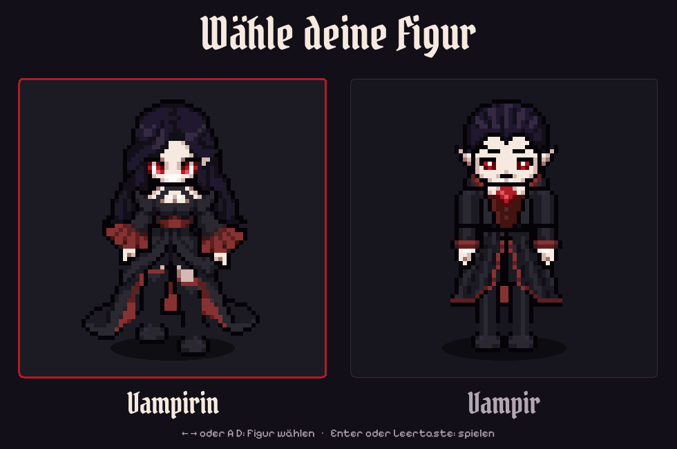
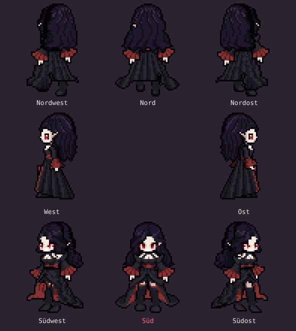
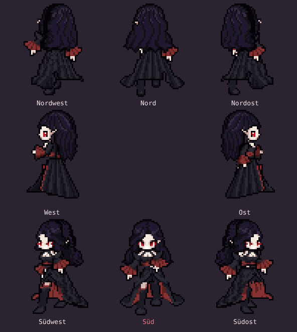
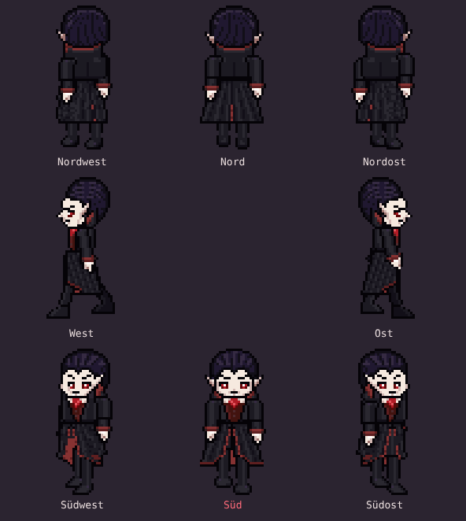
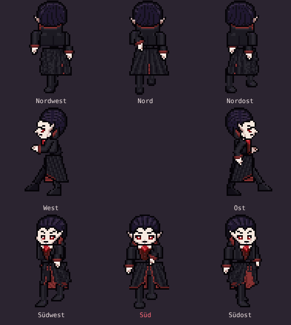
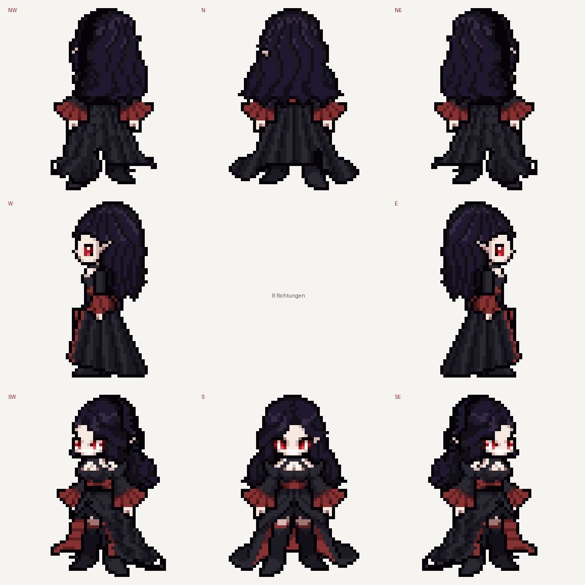
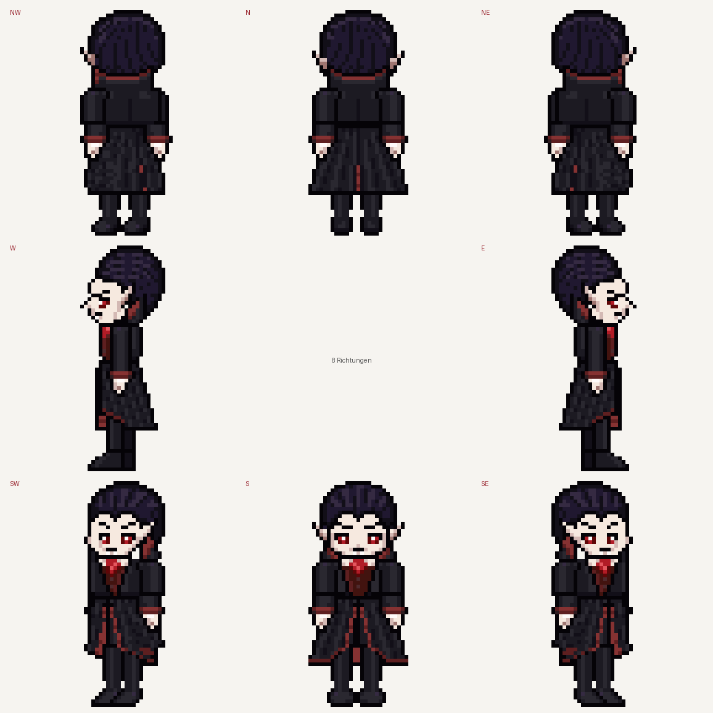

# vampiremmorpgpixelart

Ein Pixel-Art-MMORPG im Browser: **Vampire gegen Menschen**, in 3/4-Ansicht
(„schräg von oben“). Gebaut mit [Phaser 4](https://phaser.io) und [Vite](https://vite.dev).
Gespielt wird am PC im Browser mit der Tastatur.








## Stand

- **Welt:** kleine Wiese, umgeben von dichtem Wald. Bodenkacheln 32×32 px,
  Bäume als einzelne Objekte. Alles, was steht, wird nach seinem Fußpunkt
  sortiert, sodass Figuren hinter Baumkronen laufen können. Bäume, die vor der
  Figur stehen, werden dabei halbdurchsichtig.
- **Figuren:** zwei spielbare Vampire, beide 62×62 px mit derselben Palette
  (18 Farben), zerlegt in 16 Skelett-Teile, in allen **8 Himmelsrichtungen**:
  - **Vampirin:** aus dem Referenzbild rekonstruiert.
  - **Vampir:** im selben Stil neu gezeichnet: zurückgekämmte Haare mit
    Spitzansatz, Spitzohren, Stehkragen mit rotem Futter, Gehrock, Weste, Hose.
- **Figurenwahl:** Beim Start wählt man die Figur. Die Wahl wird im Browser
  gemerkt, mit `Esc` kommt man aus der Welt jederzeit zurück.
- **Steuerung:** Laufen mit WASD oder Pfeiltasten in 8 Richtungen (schräg nicht
  schneller), mit gedrückter Shift-Taste sprinten. Die Figur dreht sich in Laufrichtung. Baumstämme und der Waldrand
  blockieren, an Ecken gleitet sie vorbei. Die Kamera folgt.
- **Animation:** Laufzyklus aus 8 Bildern über das Skelett (Arme und Beine
  schwingen, Körper federt, Rock und Haare schwingen mit), im Stehen ruhiges
  Atmen. Gezeichnet wird pixelgenau: Die Figur wird in Originalgröße
  zusammengesetzt und erst danach vergrößert.

## Starten

```bash
npm install
npm run dev
```

Dann im Browser <http://localhost:5173> öffnen.

Als **eine einzige HTML-Datei** bauen, z. B. für ein claude.ai-Artefakt (Spielcode,
Grafiken und Karte eingebettet, mit Startbildschirm):

```bash
npm run build:artifact   # → dist/vampire-vs-human.html
```

| Taste | Funktion |
| --- | --- |
| `←` `→` / `A` `D` (Figurenwahl) | Figur wählen |
| `Enter` / `Leertaste` (Figurenwahl) | mit der gewählten Figur spielen (oder Figur anklicken) |
| `W` `A` `S` `D` / Pfeiltasten | laufen |
| `Shift` (gedrückt halten) | sprinten |
| `Esc` | zurück zur Figurenwahl |
| `F` | Figuren-Ansicht ↔ Welt (direkt: <http://localhost:5173/#figur>) |
| `Leertaste` (Figuren-Ansicht) | Stehen / Gehen / Sprinten |
| `B` (Figuren-Ansicht) | alle Einzelbilder des Geh- bzw. Sprintzyklus |
| `C` (Figuren-Ansicht) | Figur wechseln |

<http://localhost:5173/#welt> startet ohne Figurenwahl direkt in der Welt
(mit der zuletzt gewählten Figur).

## Projektaufbau

```
src/
  main.js                     Spiel-Konfiguration
  scenes/PreloadScene.js      lädt alle Grafiken
  scenes/SelectScene.js       Figurenwahl beim Start
  scenes/WorldScene.js        die Welt (Bäume, Spielfigur, Kamera)
  scenes/CharacterScene.js    Figuren-Ansicht (8 Richtungen, Teile, Einzelbilder)
  world/Player.js             Spielfigur: Tastatur, Bewegung, Blickrichtung
  world/collision.js          Bewegung + Kollision (ohne Phaser, auch für einen Server)
  characters/CharacterRig.js  Figur aus Teilen mit Skelett
  characters/RiggedSprite.js  zeichnet ein Rig pixelgenau in eine Textur
  characters/animations.js    Laufzyklus und Atmen als Posen
  characters/roster.js        spielbare Figuren (Name, Grafik, Bewegungsstil)
public/assets/
  tilesets/tiles.png          Bodenkacheln
  sprites/trees.png           Bäume
  maps/world.json             Karte (Format des Map-Editors „Tiled“), inkl. Kollisionsebene
  characters/vampire.*        Vampirin: Texturatlas + Skelett (rig.json)
  characters/vampire_male.*   Vampir: Texturatlas + Skelett
art/vampire/
  reference.png               Original-Vorlage
  parts/<Richtung>/NN_*.png   jedes Teil als eigene Ebene (62×62, NN = Zeichenreihenfolge)
  vampire_<Richtung>.png      zusammengesetzte Figur je Richtung
art/vampire_male/             dasselbe für den Vampir
tools/
  generate-world.mjs          erzeugt Kacheln, Bäume und Karte
  character/                  erzeugt die Vampirin aus der Vorlage (build.py)
  character/male/             zeichnet den Vampir (build_male.py)
```

## Bewegung und Kollision

Gerechnet wird mit kleinen Rechtecken am Boden: der Fußbox der Figur, einer Box
am Stammfuß jedes Baumes und vier Sperr-Rechtecken um die Wiese (Kartenebene
`collision`). `src/world/collision.js` braucht kein Phaser. Ein späterer
Spielserver kann so dieselbe Karte und dieselbe Logik verwenden.

## Die Vampirin (Skelett)

| Teil | hängt an | | Teil | hängt an |
| --- | --- | --- | --- | --- |
| `torso` (Oberkörper) | `pelvis` (Becken) | | `skirt_front` / `skirt_back` | `pelvis` |
| `head` (Kopf) | `torso` | | `thigh_R/L` (Oberschenkel) | `pelvis` |
| `hair_front` / `hair_back` | `head` | | `shin_R/L` (Schienbein) | `thigh` |
| `upper_arm_R/L` (Oberarm) | `torso` | | `foot_R/L` (Fuß) | `shin` |
| `forearm_R/L` (Unterarm + Hand) | `upper_arm` | | | |

`R`/`L` sind ihre rechte/linke Seite (in der Frontansicht ist ihr rechter Arm
also links im Bild). Verdeckte Bereiche, etwa der Oberkörper unter den Armen,
sind aufgefüllt, damit beim Bewegen keine Löcher entstehen.

`public/assets/characters/vampire.rig.json` enthält pro Richtung die Bilder,
die Gelenkpunkte (`pivots`) und die Zeichenreihenfolge. Im Spiel:

```js
const vampire = new RiggedSprite(scene, x, y, 'vampire', rig, 'S');
vampire.setDirection('NE');                    // Blickrichtung
vampire.setPose({ forearm_R: { angle: -30 } }); // Unterarm anwinkeln (Grad)
vampire.setPose(walkPose('NE', 0.25));          // Laufzyklus, rechtes Bein vorne
```

Kinder-Knochen bewegen sich automatisch mit, zum Beispiel die Hand mit dem
Oberarm.

### Laufanimation

`walkPose(richtung, phase)` in `src/characters/animations.js` berechnet die
Pose für einen Zeitpunkt im Laufzyklus (Phase 0–1 = zwei Schritte, 8 feste
Bilder für den Pixel-Look). Je nach Richtung wird gemischt:

- **seitlich (Ost/West):** Beine und Arme schwingen an Hüfte und Schulter,
  das Knie knickt beim Durchschwingen ein.
- **Front/Rücken (Süd/Nord):** Die Füße werden vor und zurück gesetzt
  (im Bild tiefer/höher) und kurz angehoben.
- **schräg (Südost, Südwest, Nordost, Nordwest):** Die Beine werden ohne Drehung
  entlang der Laufrichtung vor- und zurückgesetzt (bei Südost nach rechts unten
  bzw. links oben) und beim Durchschwingen angehoben. Der Oberschenkel geht nur
  halb mit, Schienbein und Stiefel den Rest, damit im Rockschlitz nicht zu viel
  Haut aufblitzt. Die Arme schwingen genauso entlang der Laufrichtung (gegengleich
  zu den Beinen); der Oberarm geht nur 1 px mit, damit die Schulter an ihrem Platz bleibt.

Dazu federt der Körper 1 px, die Haare federn einen Takt verzögert nach und
der Rock schwingt mit. Jede Figur kann die Bewegung anpassen (`motion` in
`src/characters/roster.js`): Die kurzen Haare des Vampirs sitzen fest am Kopf
und schwingen nicht nach. Die Schrittlänge passt zur Laufgeschwindigkeit, damit die
Füße nicht rutschen.

**Sprinten** (`runPose`, mit Shift) nutzt dieselbe Logik mit anderen Werten:
140 statt 80 px/s und weitere Schritte. In allen 8 Richtungen gilt:

- **Flugphase:** Der ganze Körper hebt zwischen zwei Schritten in einem weichen
  Bogen bis zu 2 px ab. Beim Aufsetzen federt der Oberkörper ein, der Rock
  bleibt in der Luft kurz zurück.
- **Hohe Knie:** Der durchschwingende Fuß wird 3 px angehoben (Gehen: 1 px).
- **Pumpende Arme:** Die vordere Hand zieht kräftig hoch, die hintere geht nach
  unten. Von vorne/hinten dreht der Unterarm dabei zur Körpermitte, wie ein
  angewinkelter Arm vor der Brust. Schräg pumpt die Hand senkrecht.
- **Gewichtsverlagerung:** Von vorne/hinten verlagert sich der Oberkörper über
  das Standbein, die Haare schwingen einen Takt verzögert nach.
- **Seitlich:** Oberkörper nach vorne geneigt, Arme angewinkelt, die Haare
  wehen nach hinten. Nach hinten schwingen die Beine weniger weit als nach vorne,
  damit sie nicht aus dem langen Rock herausstechen.

Gehen und Sprinten teilen sich die Phase, der Wechsel ist dadurch nahtlos.

### Wie die 8 Richtungen entstehen

- **Süd:** aus der Vorlage. Das Raster des hochskalierten Bildes wird erkannt
  und auf die Originalpixel zurückgerechnet, der angewinkelte Arm wird durch den
  gespiegelten hängenden Arm ersetzt.
- **Nord:** Rücken; Arme, Beine und Rocksilhouette aus Süd, Haare neu.
- **Ost:** Profil, neu gezeichnet.
- **Südost / Nordost:** Jede Körperpartie wird zeilenweise als Ellipse gedreht.
  Jedes Pixel stammt aus der Ansicht, die diese Stelle am frontalsten zeigt.
- **West / Südwest / Nordwest:** gespiegelt (links/rechts getauscht).
- **Füße:** Jede Richtung hat eigene Stiefel, deren Spitze in Laufrichtung zeigt:
  in Süd zur Kamera, in Nord sieht man die Absätze, in den Schrägansichten zeigen
  beide Spitzen schräg (`tools/character/feet.py`). In der Frontansicht steht
  sie dafür gerade; das in der Vorlage nach außen gedrehte linke Bein ist durch
  das gespiegelte rechte ersetzt.



Alles neu bauen (benötigt Python 3 mit Pillow und numpy):

```bash
python3 tools/character/build.py
```

## Der Vampir

Der Vampir hat keine Vorlage, er ist direkt in Python als Pixel-Raster
gezeichnet (`tools/character/male/`). Palette, Größe, Skelett und
Gelenkpunkte sind dieselben wie bei der Vampirin. Deshalb passen dieselben
Geh- und Sprintanimationen.

- **Süd, Nord, Ost:** gezeichnet. Der Gehrock nutzt die Rock-Knochen
  (`skirt_front`/`skirt_back`): Die Rockschöße schwingen beim Laufen mit, in
  der vorderen Öffnung blitzt das rote Futter.
- **Südost / Nordost:** Arme, Gehrock und Beine entstehen wie bei der
  Vampirin durch Drehen. Kopf und Oberkörper sind von Hand gezeichnet, weil
  Spitzohren, Kragen und Weste beim Drehen Lücken hinterlassen.
- **West / Südwest / Nordwest:** gespiegelt.



```bash
python3 tools/character/build_male.py
```

Die Welt neu erzeugen (überschreibt Karte und Grafiken):

```bash
npm run generate:world
```
